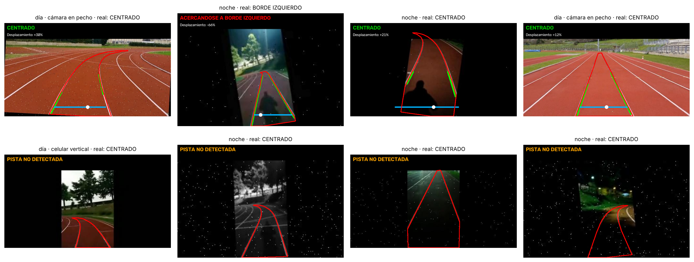

# Independencia deportiva: detección de carril para atletas con discapacidad visual

Prototipo en Python que detecta en video los límites de un carril de atletismo y avisa cuando la persona se acerca a uno de sus bordes. Proyecto del Programa de Estímulos Económicos a Estudiantes Sobresalientes (PEEES 2026), CUGDL, Universidad de Guadalajara.

- **Becario:** Miguel Isay Morales Cortés
- **Investigador responsable:** Rafael Morales Gamboa

> Es una estimación visual, no una medición en metros. No sustituye a un guía.

[](https://colab.research.google.com/github/I-say/independencia-deportiva-carril/blob/main/Prototipo_carril_v2.ipynb)

## Cómo usarlo

1. Abre el cuaderno con el botón **Abrir en Colab**.
2. Ejecuta todas las celdas (*Entorno de ejecución → Ejecutar todas*).
3. Opcional: en la sección 5 sube un video propio grabado desde el pecho.

Para correrlo en tu computadora (Python 3.10 o superior y Git instalados):

```bash
git clone https://github.com/I-say/independencia-deportiva-carril
cd independencia-deportiva-carril
pip install -r requirements.txt jupyter
jupyter notebook Prototipo_carril_v2.ipynb
```

## Reproducibilidad

- **Datos en versión fija:** el cuaderno descarga TrackAid-DT y se coloca en el commit `aecdd7ad75c5d0f14c723c4a073568e6b7afa875` (17 de junio de 2026), aunque el repositorio original cambie después.
- **Librerías en versión fija:** `requirements.txt` tiene las versiones con las que se generaron los resultados publicados (OpenCV 4.12, la misma de Colab). La primera celda imprime las versiones usadas.
- **Azar controlado:** el video artificial, la división ajuste/prueba y los ejemplos usan semillas fijas.
- **Comprobación:** con OpenCV 4.12 y 5.0, `resultados/resultados_trackaid.csv` sale idéntico. En el video artificial los aciertos pueden variar ±1 punto porque el ruido simulado se genera ligeramente distinto.
- Para verificar, ejecuta todo y compara tu `resultados_trackaid.csv` con el de la carpeta `resultados/`.

## Cómo funciona

1. Se queda con las zonas claras de la parte baja de la imagen (las líneas de la pista son blancas).
2. Busca bordes (Canny) y segmentos rectos (Hough).
3. Toma la línea más cercana al centro de cada lado y calcula qué tan desplazada está la cámara respecto al centro del carril.
4. Si el desplazamiento pasa de 30 % del semiancho del carril, muestra una alerta.

## Resultados preliminares

Evaluación contra las anotaciones manuales de [TrackAid-DT](https://github.com/vrai-group/TrackAid-DT), con 8 videos que no se usaron para ajustar parámetros (172 fotos):

| Métrica | v1 | v2 |
| --- | --- | --- |
| Carril detectado | 70 % | 77 % |
| Estado correcto, de las detectadas | 90 % | 89 % |
| Estado correcto, del total | 63 % | 69 % |

Detección por condición (245 fotos):

| Condición | v1 | v2 |
| --- | --- | --- |
| Día, cámara en el pecho | 90 % | 94 % |
| Noche | 21 % | 64 % |
| Día, celular vertical | 41 % | 43 % |

En video artificial con vibración de cámara, promediar los últimos 5 cuadros sube los aciertos de 85 % a 96 % y reduce los cambios de alerta de 54 a 6, con un retraso de 2 a 3 cuadros.



En rojo, el carril marcado a mano; en verde, las líneas que encontró el detector.

## Archivos

| Archivo | Contenido |
| --- | --- |
| `Prototipo_carril_v2.ipynb` | Versión actual, ya ejecutada con sus resultados |
| `Prototipo_carril_v1.ipynb` | Primera versión (referencia) |
| `resultados/resultados_trackaid.csv` | Resultado por foto: desplazamiento real, detectado y estado |
| `resultados/*.png` | Ejemplos visuales |

## Limitaciones

- En 9 de 245 fotos indica CENTRADO estando cerca de un borde; es el error prioritario a reducir.
- Busca líneas rectas: las curvas y los carriles vecinos pueden confundirlo.
- El suavizado solo se ha probado con video artificial.
- El umbral de 30 % es una proporción en la imagen, no una distancia calibrada.

## Referencias

- De León, C., Morales, R. y Morales, J. J. (2023). Independencia deportiva: prototipo inteligente para atletas con discapacidad visual. *ATICA 2023*, pp. 17–20.
- Narang, G., Galdelli, A., Kuznetsov, O., Zingaretti, P. y Mancini, A. (2026). TrackAid-DT: An egocentric vision dataset and benchmarks for lane detection in visually impaired athlete guidance. *Computer Vision and Image Understanding*. https://doi.org/10.1016/j.cviu.2026.104788

Los datos de TrackAid-DT se usan bajo licencia CC BY 4.0 y no se incluyen en este repositorio; el cuaderno los descarga desde su repositorio original.
